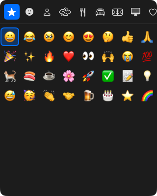

# EmojiBako

[日本語](#日本語) | [English](#english)



## 日本語

EmojiBakoは、ホットキーで呼び出して日本語で検索できる、macOSのメニューバー常駐型の絵文字ピッカーです。

### 特長

- **どこからでも呼び出せる**: 初期設定では`⌘.`でピッカーが開きます。ホットキーは設定画面で変更できます。
- **日本語で検索できる**: 「ねこ」「ネコ」「猫」「cat」のどれでも🐈が見つかります。IMEで変換中のひらがなでも絞り込めます。
- **よく使う絵文字が先頭に並ぶ**: 使用回数の多い絵文字から表示します。
- **クリップボードを元に戻す**: 絵文字の入力に一時的に使ったクリップボードは、画像やファイルなどの形式も含めて元の内容に戻します（提供元のアプリが後からデータを渡す形式など、戻せないものもあります）。

### 動作環境

- macOS 14.4以降
- Apple Silicon搭載のMac

### インストール

1. [Releases](https://github.com/tmstack-io/EmojiBako/releases/latest)から最新のDMGをダウンロードします。
2. DMGを開き、EmojiBakoを「アプリケーション」フォルダにドラッグします。
3. EmojiBakoを起動し、案内に従ってアクセシビリティを許可します。

### 使い方

| 操作 | キー |
|------|------|
| ピッカーを開く・閉じる | `⌘.`（設定で変更可） |
| 絵文字を選ぶ | 矢印キー |
| 選んだ絵文字を入力する | `Enter` |
| カテゴリを切り替える | `Tab`・`Shift + Tab` |
| 検索を始める・終える | `⌘F` |
| 閉じる | `Esc` |

メニューバーのアイコンをクリックしてもピッカーを開けます。右クリックすると、設定と終了のメニューが出ます。

### 権限と通信

- **アクセシビリティ**: 選んだ絵文字を作業中のアプリに入力するために、`⌘V`のキー操作を送ります。そのために必要です。
- **クリップボード**: 絵文字の入力のために一時的に使い、初期設定では1秒後に元の内容に戻します。クリップボード管理アプリの履歴に残さないための印も付けます。貼り付け先のアプリが遅く、絵文字ではなく元の内容が貼り付けられる場合は、設定で戻すまでの時間を長くしてください。
- **通信**: 外部と通信するのは、GitHubで新しいバージョンを確認するときだけです（1日1回）。設定でオフにできます。解析やクラッシュレポートの送信は行いません。

### 開発

```sh
xcodegen generate                                   # project.ymlからXcodeプロジェクトを生成する
xcodebuild -scheme EmojiBako test                   # テスト
swift scripts/generate-emoji-data.swift             # 絵文字データを生成する
swift scripts/check-readings.swift                  # 読みをclaude -pでチェックする
zsh scripts/release.sh                              # 署名・公証済みのDMGを作る
```

設計上の判断は[docs/adr](docs/adr)に、用語は[GLOSSARY.md](GLOSSARY.md)に、仕様は[SPECIFICATION.md](SPECIFICATION.md)にまとめています。

### ライセンス

EmojiBakoは[MITライセンス](LICENSE)で公開しています。絵文字の名前とキーワードには、Unicode, Inc.のデータ（[Unicode License v3](LICENSE-UNICODE.txt)）を使用しています。

## English

EmojiBako is a menu bar emoji picker for macOS that opens with a hotkey and lets you search in Japanese as well as English.

### Features

- **Open it from anywhere**: Press `⌘.` by default. You can change the hotkey in Settings.
- **Search in Japanese or English**: 「ねこ」, 「ネコ」, 「猫」, and "cat" all find 🐈. Results update while you are still composing with a Japanese input method.
- **Frequently used emoji first**: Emoji you use most appear first.
- **Your clipboard is restored**: The clipboard is used briefly to type the emoji, then restored with its contents, including images and files (some formats that the source app provides on demand cannot be restored).

### Requirements

- macOS 14.4 or later
- Mac with Apple silicon

### Installation

1. Download the latest DMG from [Releases](https://github.com/tmstack-io/EmojiBako/releases/latest).
2. Open the DMG and drag EmojiBako to the Applications folder.
3. Launch EmojiBako and allow Accessibility access when prompted.

### Usage

| Action | Key |
|--------|-----|
| Open or close the picker | `⌘.` (configurable) |
| Move the selection | Arrow keys |
| Type the selected emoji | `Enter` |
| Switch category | `Tab` / `Shift + Tab` |
| Start or end search | `⌘F` |
| Close | `Esc` |

You can also click the menu bar icon to open the picker. Right-click it for Settings and Quit.

### Permissions and network access

- **Accessibility**: EmojiBako sends `⌘V` to type the emoji you pick into the app you are working in, which requires this permission.
- **Clipboard**: Used briefly to type the emoji and restored after 1 second by default, marked so that clipboard managers do not record it. If the previous content gets pasted instead of the emoji because the target app is slow, increase the delay in Settings.
- **Network**: The only network access is a check for new versions on GitHub, once a day. You can turn it off in Settings. EmojiBako does not send analytics or crash reports.

### License

EmojiBako is released under the [MIT License](LICENSE). Emoji names and keywords use data from Unicode, Inc. under the [Unicode License v3](LICENSE-UNICODE.txt).
